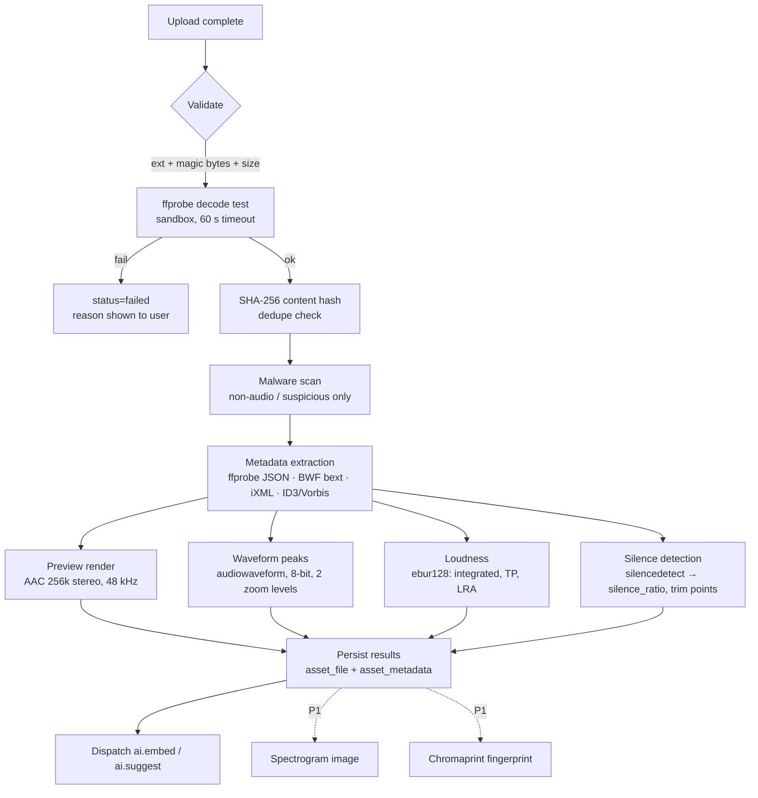

# Audio Processing Pipeline (Phase 0.7)

Status: Proposed · Date: 2026-11-07 · Module: M3 · Tools and licences: see [08 §4](../research/08_technical_stack_evaluation.md)

## 1. Pipeline overview

## 2. Step specifications

| Step | Tool / command (indicative) | Output | Notes |
|---|---|---|---|
| Validate | Extension allow-list; magic bytes (`RIFF/WAVE`, `RF64`, `FORM/AIFF`, `fLaC`, `ID3`/MPEG sync, `OggS`) | pass/fail | Reject archives, executables, unknown types |
| Decode test | `ffprobe -v error -show_streams -show_format -of json` | stream info | Run as non-root in a container with no network; cgroup CPU/mem limits |
| Hash | Streaming SHA-256 from object storage | `content_sha256` | Exact-duplicate detection |
| Metadata | ffprobe tags + **wavinfo** (BWF `bext`: Description, Originator, OriginationDate, TimeReference; iXML: PROJECT, SCENE, TAKE, NOTE, TRACK_LIST, USER) + mutagen (ID3/Vorbis) | `asset_metadata.*` JSONB, plus mapped fields (description → `description`, keywords → tags with `source=embedded`) | **Never rewrite originals during ingest** |
| UCS parse | Filename pattern `CatID_FXName_CreatorID_SourceID` [T] S36 | `ucs_cat_id`, parsed fields | When the filename already follows UCS |
| Preview | `ffmpeg -i in -vn -ac 2 -ar 48000 -c:a aac -b:a 256k -movflags +faststart preview.m4a` | `preview_aac` | Multichannel → stereo downmix for preview; original kept. Optional Opus variant |
| Peaks | `audiowaveform -i in.wav -o peaks.dat -b 8 --pixels-per-second 20` (+ a high-res level for files > 60 s) | `peaks` | Consumed by WaveSurfer/peaks.js [V] S48–S49 |
| Loudness | `ffmpeg -i in -af ebur128=peak=true -f null -` (parse summary) | LUFS-I, LRA, true peak | Cross-check with pyloudnorm in tests |
| Silence | `ffmpeg -i in -af silencedetect=noise=-60dB:d=0.5 -f null -` | silence segments, ratio | Used for trimming hints and AI chunk selection |
| Spectrogram (P1) | `ffmpeg -i in -lavfi showspectrumpic=s=1024x256:legend=0 spec.png` | `spectrogram` | |
| Fingerprint (P1) | Chromaprint library (LGPL) | fingerprint | Near-duplicates across re-encodes |
| Normalisation | **Preview only**, optional (`loudnorm` two-pass, e.g. −16 LUFS for comfortable auditioning) | normalized preview | Toggle in UI; originals untouched |

## 3. Format support matrix (MVP)
| Format | Ingest | Notes |
|---|---|---|
| WAV / BWF (PCM 16/24/32f) | ✅ | Primary pro format |
| RF64 / BW64 (> 4 GB) | ✅ | Verify ffprobe + wavinfo support (PQ-1) |
| Polyphonic WAV (multi-channel field recordings) | ✅ | iXML TRACK_LIST names channels |
| AIFF / AIFC | ✅ | |
| FLAC | ✅ | |
| MP3, AAC/M4A, OGG Vorbis, Opus | ✅ | |
| Ambisonics (B-format) | ◐ | Ingest as multichannel; binaural preview P3 |
| DSD, proprietary DAW sessions | ❌ | Out of scope |

## 4. Performance and scaling
- Workers stream from object storage to local scratch (NVMe/ephemeral). Clean up after each job.
- Steps fan out after metadata (preview, peaks, loudness, silence run in parallel processes).
- Queue routing: `audio_cpu` queue; concurrency = vCPUs; files > 2 GB go to a `audio_cpu_large` queue with more memory.
- Throughput target ≥ 5,000 short SFX/hour/worker [A] → **benchmark PQ-2**.

## 5. Failure handling
| Failure | Behaviour |
|---|---|
| Decode error | `failed` with a readable reason; original kept for 7 days for re-try/support, then deleted |
| Transient (storage/network) | Retry ×5, exponential backoff |
| Step timeout | Mark step failed; others continue; asset may be `ready` with partial features |
| Model/tool upgrade | Bump `pipeline_version` → back-fill job re-runs only the affected steps |

## 6. Open pipeline questions
- PQ-1: RF64/BW64 and >4 GB WAV handling in wavinfo/ffprobe.
- PQ-2: Throughput benchmark on target instance types.
- PQ-3: Exact licence of FFmpeg filters used (`ebur128`, `loudnorm`, `silencedetect`, `showspectrumpic`) in our chosen LGPL build.
- PQ-4: Metadata write-back (P1): which librarians read which fields (Soundminer/Soundly/BaseHead interop test).
