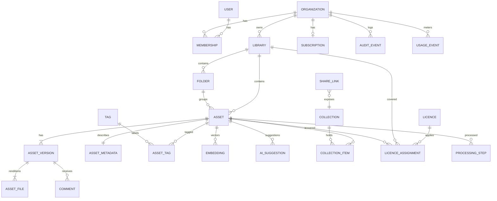

# Database Design (Phase 0.7)

Status: Proposed (logical model, not a migration) · PostgreSQL 16+ with `pgvector`, `pg_trgm`, `citext` · Date: 2026-11-07

## 1. Conventions
- Primary keys: `uuid` (UUIDv7 for time-ordered inserts [K]).
- Every tenant-owned table has `org_id uuid NOT NULL` + RLS policy `org_id = current_setting('app.current_org')::uuid`.
- `created_at`, `updated_at timestamptz`; soft delete via `deleted_at` where restore is a feature.
- Money in integer minor units + ISO currency; never floats.
- Append-only tables (audit, usage, ledger) have no UPDATE/DELETE grants for the app role.

## 2. Entity-relationship overview (MVP + forward-compatible)



## 3. Core tables (abridged DDL sketch)

```sql
-- Identity
create table organization (id uuid primary key, name text not null, kind text not null check (kind in ('personal','team')),
  plan_code text not null, data_region text not null default 'eu', created_at timestamptz not null default now());
create table app_user (id uuid primary key, idp_subject text unique not null, email citext unique not null,
  display_name text, created_at timestamptz not null default now(), deleted_at timestamptz);
create table membership (org_id uuid references organization, user_id uuid references app_user,
  role text not null check (role in ('owner','admin','editor','contributor','viewer')), primary key (org_id, user_id));

-- Assets
create table library (id uuid primary key, org_id uuid not null references organization, name text not null,
  source_kind text not null check (source_kind in ('uploaded','byo_bucket','previews_only')),
  storage_connection_id uuid, restricted boolean not null default false, created_at timestamptz not null default now());
create table asset (id uuid primary key, org_id uuid not null, library_id uuid not null references library,
  folder_id uuid, filename text not null, title text, description text,
  ucs_cat_id text, status text not null check (status in ('uploading','processing','ready','failed','deleted')),
  content_sha256 bytea, duration_ms integer, current_version_id uuid,
  search_tsv tsvector generated always as (to_tsvector('simple', coalesce(filename,'')||' '||coalesce(title,'')||' '||coalesce(description,''))) stored,
  created_by uuid, created_at timestamptz not null default now(), deleted_at timestamptz);
create index on asset using gin (search_tsv);
create index on asset using gin (filename gin_trgm_ops);
create index on asset (org_id, library_id, created_at desc);
create unique index on asset (org_id, content_sha256) where deleted_at is null;  -- exact dedupe per org (configurable)

create table asset_version (id uuid primary key, org_id uuid not null, asset_id uuid not null references asset,
  number integer not null, note text, created_by uuid, created_at timestamptz not null default now(), unique (asset_id, number));
create table asset_file (id uuid primary key, org_id uuid not null, version_id uuid not null references asset_version,
  role text not null check (role in ('original','preview_aac','preview_opus','peaks','spectrogram')),
  storage_key text not null, bytes bigint not null, mime text not null, codec text, created_at timestamptz not null default now());

create table asset_metadata (asset_id uuid primary key references asset, org_id uuid not null,
  sample_rate integer, bit_depth smallint, channels smallint, codec text, container text,
  loudness_lufs real, true_peak_dbtp real, loudness_range_lu real, silence_ratio real,
  bwf_bext jsonb, ixml jsonb, id3 jsonb, raw_probe jsonb,          -- lossless embedded metadata
  bpm real, musical_key text);                                     -- P2

create table tag (id uuid primary key, org_id uuid, name citext not null, vocabulary text not null default 'free',  -- 'free' | 'ucs' | 'audioset'
  unique (org_id, vocabulary, name));
create table asset_tag (asset_id uuid, tag_id uuid, org_id uuid not null, source text not null check (source in ('user','embedded','ai_accepted')),
  primary key (asset_id, tag_id));

-- AI
create extension if not exists vector;
create table model_version (id text primary key, family text not null, weights_sha256 text not null, dims integer, created_at timestamptz default now());
create table embedding (asset_id uuid not null references asset, org_id uuid not null, model_id text not null references model_version,
  chunk_idx smallint not null default -1,          -- -1 = pooled whole-file vector
  vec halfvec(512) not null, primary key (asset_id, model_id, chunk_idx));
create index on embedding using hnsw (vec halfvec_cosine_ops) where chunk_idx = -1;
create table ai_suggestion (id uuid primary key, org_id uuid not null, asset_id uuid not null, kind text not null check (kind in ('tag','ucs','description')),
  label text not null, score real not null, model_id text not null, status text not null default 'pending' check (status in ('pending','accepted','rejected')));

-- Licensing
create table licence (id uuid primary key, org_id uuid not null, licensor text not null,
  kind text not null check (kind in ('owned','commercial_eula','cc0','cc_by','cc_by_nc','cc_by_sa','subscription','custom')),
  seats integer, territory text, term_end date, attribution text, restrictions text, evidence_file_id uuid);
create table licence_assignment (licence_id uuid references licence, org_id uuid not null, library_id uuid, asset_id uuid,
  check ((library_id is null) <> (asset_id is null)));

-- Collaboration
create table collection (id uuid primary key, org_id uuid not null, name text not null, created_by uuid);
create table collection_item (collection_id uuid, asset_id uuid, org_id uuid not null, position integer, primary key (collection_id, asset_id));
create table share_link (id uuid primary key, org_id uuid not null, token_hash bytea unique not null, target_kind text, target_id uuid,
  passphrase_hash text, expires_at timestamptz, allow_download boolean default false, revoked_at timestamptz);
create table comment (id uuid primary key, org_id uuid not null, version_id uuid not null, t_start_ms integer, t_end_ms integer,
  body text not null, author_user_id uuid, author_guest_name text, resolved_at timestamptz, created_at timestamptz default now());

-- Processing
create table processing_step (asset_id uuid, org_id uuid not null, step text, pipeline_version text, status text,
  attempts smallint default 0, error text, started_at timestamptz, finished_at timestamptz, primary key (asset_id, step, pipeline_version));
create table outbox (id bigserial primary key, topic text not null, payload jsonb not null, created_at timestamptz default now(), dispatched_at timestamptz);

-- Billing (provider is source of truth)
create table subscription (org_id uuid primary key references organization, provider text, provider_sub_id text unique,
  plan_code text, status text, seats integer, current_period_end timestamptz);
create table usage_event (id bigserial, org_id uuid not null, metric text not null, quantity bigint not null, occurred_at timestamptz not null default now())
  partition by range (occurred_at);
create table billing_webhook_event (provider_event_id text primary key, received_at timestamptz default now(), payload jsonb);

-- Audit (append-only, partitioned monthly)
create table audit_event (id bigserial, org_id uuid, actor_user_id uuid, actor_kind text, action text not null,
  target_kind text, target_id uuid, ip inet, user_agent text, details jsonb, occurred_at timestamptz not null default now())
  partition by range (occurred_at);

-- Privacy
create table consent_record (id uuid primary key, user_id uuid, purpose text, granted boolean, notice_version text, recorded_at timestamptz default now());
create table data_request (id uuid primary key, user_id uuid, kind text check (kind in ('access','erasure','correction','portability')),
  status text, due_at timestamptz, completed_at timestamptz);
```

## 4. Hybrid search query (sketch)
```sql
-- :q_vec = CLAP text embedding, :q = plain query, org scoped by RLS
with fts as (
  select id, row_number() over (order by ts_rank(search_tsv, plainto_tsquery('simple', :q)) desc) r
  from asset where search_tsv @@ plainto_tsquery('simple', :q) and status='ready' limit 200),
vec as (
  select e.asset_id id, row_number() over (order by e.vec <=> :q_vec) r
  from embedding e where e.chunk_idx = -1 and e.model_id = :model order by e.vec <=> :q_vec limit 200)
select id, sum(1.0/(60 + r)) score               -- Reciprocal Rank Fusion, k=60
from (select * from fts union all select * from vec) u group by id order by score desc limit 50;
```

## 5. Sizing estimates [calc/A]
| Item | Per 1M assets |
|---|---|
| `asset` + metadata rows | ~2–4 GB incl. indexes (JSONB size varies) |
| Pooled embeddings (halfvec 512) | ~1 GB + HNSW index ~1–2 GB |
| Chunk embeddings (avg 3 chunks/asset, P1) | ~3 GB + optional index |
| Audit events | Grows with activity; partition + archive after 13 months |

## 6. Open DB questions
- DQ-1: Per-org dedupe vs per-library dedupe (users may want the same file in two libraries).
- DQ-2: Whether to index chunk-level vectors (better for long files; 3× index size).
- DQ-3: RLS performance with connection pooling (set `app.current_org` per transaction with `SET LOCAL`; verify with PgBouncer transaction mode).
