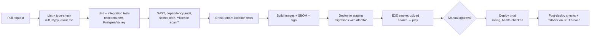

# Deployment Architecture (Phase 0.7)

Status: Proposed · Date: 2026-11-07 · Infra analysis: [10](../research/10_storage_and_infrastructure_analysis.md)

## 1. Initial production topology (single region)

```mermaid
flowchart TB
    subgraph Edge["Cloudflare"]
        DNS[DNS] --> WAF[WAF + DDoS + Rate limiting]
        WAF --> CDN[CDN cache<br/>static assets, public previews]
    end
    subgraph App["Managed container platform (one region)"]
        WEB1[web · Next.js ×2]
        API1[api · FastAPI ×2<br/>uvicorn/gunicorn]
        WCPU[worker-cpu ×2–N<br/>autoscale on queue depth]
        WBEAT[scheduler · celery beat ×1]
    end
    subgraph GPU["Serverless GPU provider"]
        WGPU[worker-gpu<br/>scale-to-zero]
    end
    subgraph Data["Managed data services"]
        PG[(PostgreSQL 16 + pgvector<br/>primary + standby, PITR)]
        PGB[PgBouncer / built-in pooler]
        VK[(Valkey<br/>broker + cache)]
    end
    subgraph Storage["Object storage"]
        R2[(R2 bucket: aos-prod<br/>org/{org}/assets/…)]
        B2[(B2 bucket: aos-dr<br/>replica of originals)]
    end
    subgraph Ops["Operations"]
        OTEL[OpenTelemetry collector]
        LOGS[Logs + metrics + traces]
        SENTRY[Sentry]
        STATUS[Status page + uptime checks]
    end
    CDN --> WEB1
    WAF --> API1
    WEB1 --> API1
    API1 --> PGB --> PG
    API1 --> VK
    VK --> WCPU
    VK --> WGPU
    WCPU --> R2
    WGPU --> R2
    API1 -. presign .-> R2
    R2 -. scheduled replication job .-> B2
    App --> OTEL --> LOGS
    App --> SENTRY
```

## 2. Environments
| Env | Purpose | Data |
|---|---|---|
| `local` | Docker Compose: postgres+pgvector, valkey, MinIO-compatible local S3 (or a fork such as Garage), api, worker, web | Synthetic + CC0 test audio |
| `staging` | Same topology, smaller sizes; separate cloud account/project; separate buckets | Synthetic only. **No production customer audio** |
| `prod` | As above | Customer data |

> Note: MinIO's community repository was archived in Feb 2026 [T] S43. For **local development only**, a pinned MinIO image, a maintained fork, or an alternative S3 emulator is acceptable. Production uses R2.

## 3. CI/CD (GitHub Actions)

- DB migrations: expand → migrate → contract (backward compatible across one release).
- Model weights are baked into GPU images by hash, or pulled from a private bucket at start-up with hash verification.

## 4. Sizing at launch [A]
| Component | Size | Scale trigger |
|---|---|---|
| web | 2 × 0.5–1 vCPU / 1 GB | CPU > 60% |
| api | 2 × 1–2 vCPU / 2–4 GB (CLAP text encoder in memory ≈ 1 GB [A]) | p95 latency, CPU |
| worker-cpu | 2 × 4 vCPU / 8 GB, autoscale to 10 | queue depth > 500 or age > 5 min |
| worker-gpu | 0–4 × L4-class, scale-to-zero | queue `ml_gpu` depth |
| Postgres | 4 vCPU / 16 GB / 200 GB SSD, HA | CPU, buffer-cache hit ratio, vector index size vs RAM |
| Valkey | 1–2 GB managed | memory |

## 5. Operational SLOs and alerts [A]
| SLO | Target | Alert |
|---|---|---|
| API availability | 99.5% / month | 5xx rate > 1% for 5 min |
| Search latency | p95 < 500 ms | p95 > 800 ms for 10 min |
| Ingest freshness | 95% of files ready < 10 min after upload | oldest job age > 30 min |
| Backup | Daily DB snapshot + PITR OK; B2 replication lag < 24 h | job failure |

## 6. Security posture in deployment
- Private networking between app and data services where the platform supports it; DB not publicly reachable.
- Workers that decode media run with no outbound internet except object storage and the queue.
- Per-environment secrets; rotation runbook; break-glass access audited.
- Data region chosen by founder decision D-06 (EU vs India); R2 jurisdiction/location hints to be verified (IQ-2).
