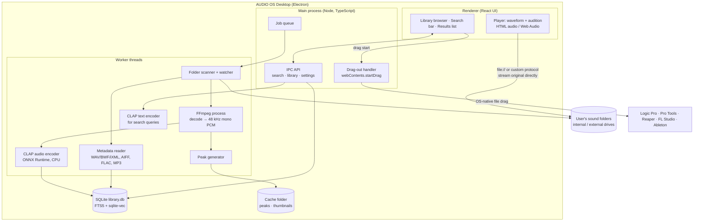

# Desktop App Architecture (Alpha v0.1, local-first)

Status: **Proposed (revision 2026-11-07)**. Supersedes "web-first" for the first release (see ADR-013).
Context: The founder has a ready test group: **1 macOS user (Logic Pro)** and **2 Windows users (including the founder)**. A local desktop app addresses the top risks in the R&D report: DAW drag-in (R-03), storage cost (R-06) and licensing of commercial SFX in the cloud (R-02).

## 1. Product shape of the alpha
> **A fast local sound library app for Mac and Windows.** Point it at your sample/SFX folders. It indexes them **where they are** (no copying, no upload), lets you audition instantly, search by keywords **or by describing a sound**, find "more like this", and **drag the sound straight into Logic Pro or any DAW**.

Nothing leaves the user's computer in the alpha (except opt-in crash reports and feedback).

## 2. Platform requirements
| Requirement | Why |
|---|---|
| **macOS (Apple Silicon first; Intel optional)** | The Logic Pro tester. Logic is Mac-only [K] |
| **Windows 10/11 x64** | Founder + one tester |
| Same UI and features on both | One codebase |
| Works offline, on CPU only (no GPU required) | Typical laptops |
| Drag a file from the app into a DAW timeline | Core workflow (must be tested in Logic Pro and in the testers' Windows DAWs) |

## 3. Recommended stack

| Layer | Choice | Reason | Licence |
|---|---|---|---|
| App shell | **Electron** | Bundles Chromium, so **audio playback and codecs behave identically on Mac and Windows**. Official native file drag-out API: `webContents.startDrag({file, icon})` from the main process [V] S69 | MIT [K] |
| UI | React + TypeScript + Tailwind + shadcn/ui (same as the planned web app) | Reusable later for the cloud/team version | MIT [K] |
| Waveform | WaveSurfer.js with **peaks we compute ourselves** | BBC audiowaveform is GPL-3, which is **not OK to bundle** in a closed-source app [K] | BSD-3 [V] |
| AI engine | **Transformers.js + ONNX Runtime (Node)** running **LAION CLAP** (`Xenova/clap-htsat-unfused`: ONNX weights, audio + text embedding models, 512-dim) [V] S70 | **No Python needed**: one language (TypeScript) and a much smaller installer | CLAP Apache-2.0 [V]; Transformers.js Apache-2.0 [K]; ONNX Runtime MIT [K] |
| Database | **SQLite** (better-sqlite3) + **FTS5** for keyword search + **sqlite-vec** for vectors | Single local file, fast, zero setup. sqlite-vec is MIT/Apache dual-licensed, runs on Mac and Windows; **pre-v1, so expect breaking changes** [V] S71 | Public domain / MIT / MIT-Apache |
| Audio decode / previews | **FFmpeg (LGPL build)** binary bundled, called as a separate process | Reads every format; LGPL obligations met by shipping it as a separate unmodified binary + licence notice + source offer [K, counsel to confirm] | LGPL-2.1+ |
| Metadata (BWF bext / iXML / ID3) | Own small RIFF chunk reader in TypeScript + `music-metadata` (verify licence) | Avoid GPL `mutagen` in distributed software | [K] verify |
| Background work | Node worker threads (indexing, embedding) with a job queue in SQLite | Keeps UI smooth during indexing | — |
| File watching | chokidar (or native fs.watch) | New files are indexed automatically | MIT [K] |
| Updates | electron-updater (GitHub Releases as host for the alpha) | Testers get fixes automatically | MIT [K] |
| Crash and feedback | Sentry (opt-in) + in-app feedback form | Learn from testers | — |
| Build / CI | electron-builder + GitHub Actions (**macOS runner for the Mac build**, Windows runner for .exe/NSIS installer) | **The founder does not need to own a Mac to produce the Mac build** | — |

### Why not the alternatives
| Alternative | Reason not chosen (for alpha) |
|---|---|
| Tauri | Smaller app, but uses **WKWebView (Safari engine) on Mac and WebView2 on Windows**, so audio/codec behaviour differs per OS; drag-out needs a plugin. Reconsider later for size |
| Python sidecar (FastAPI + PyInstaller) | Was the plan for the web backend. On desktop it adds a second runtime and hundreds of MB; Transformers.js already runs CLAP in Node |
| JUCE / native C++ | Best audio performance, but much slower UI development; worth it only if we build a DAW plugin later |

## 4. Architecture



### Key design points
1. **Index in place.** We store only the file path, file size + modified time (to detect changes), metadata, peaks and the embedding. **Original files are never copied, moved or modified.**
2. **Play originals directly from disk.** On desktop we don't need preview files: local WAVs stream instantly through a custom protocol (`aos-file://`) that only serves files inside indexed folders (a security restriction).
3. **Drag-out.** On drag start, the UI sends the file path to the main process, which calls `startDrag` [V] S69, and the OS hands the real file to the DAW. **Test in Logic Pro first.** Logic accepts Finder drags [K], and an Electron native drag should behave the same, but this is **unverified**.
4. **Long files.** Embed 10-second windows (skipping silence) and average them, as in [ai_pipeline.md](ai_pipeline.md).
5. **Offline AI.** The model is bundled in the installer (or downloaded on first launch to keep the installer small). No internet is needed afterwards.
6. **External drives.** If a drive is unplugged, its sounds show as "offline" (greyed out) instead of being deleted from the index.

## 5. Local data model (SQLite, simplified)
```sql
create table library_root (id integer primary key, path text unique, label text, added_at text, online integer default 1);
create table sound (
  id integer primary key, root_id integer references library_root, rel_path text, filename text,
  size_bytes integer, mtime integer, duration_ms integer, sample_rate integer, bit_depth integer, channels integer,
  description text, ucs_cat_id text, bext_json text, ixml_json text, tags text,
  loudness_lufs real, status text check (status in ('new','indexed','failed','offline')),
  unique (root_id, rel_path));
create virtual table sound_fts using fts5(filename, description, tags, content='sound', content_rowid='id');
create virtual table sound_vec using vec0(embedding float[512]);          -- rowid = sound.id
create table suggestion (sound_id integer, kind text, label text, score real, status text default 'pending');
create table collection (id integer primary key, name text);
create table collection_item (collection_id integer, sound_id integer, primary key (collection_id, sound_id));
create table settings (key text primary key, value text);
```

## 6. Alpha v0.1 feature scope
| # | Feature | Priority |
|---|---|---|
| A1 | Add folders (internal/external drives), background indexing with progress, auto-watch for new files | Must |
| A2 | Library browser: folders, file list (virtualised), columns (name, duration, SR, bit depth, channels, UCS) | Must |
| A3 | Instant audition: click/arrow keys, spacebar, waveform scrub, loop, volume | Must |
| A4 | Keyword search + filters (duration, SR, channels, folder) | Must |
| A5 | **AI search**: type a description ("distant thunder rumble") | Must |
| A6 | **More like this** (similar sounds) | Must |
| A7 | **Drag into DAW** (Logic Pro on Mac + testers' Windows DAWs) | Must |
| A8 | Read embedded metadata (BWF description, iXML, ID3) and UCS from filenames | Must |
| A9 | AI tag + UCS category suggestions (view only; accept into local tags) | Should |
| A10 | Favourites / collections | Should |
| A11 | Duplicate detection (same content hash) | Could |
| A12 | Opt-in crash reports + in-app "Send feedback" | Must |
| — | Cloud sync, team sharing, review links, accounts, payments | **Not in alpha** |

## 7. Performance targets [A, to benchmark in Week 1–2]
| Metric | Target |
|---|---|
| App start to usable | < 3 s |
| Keyword search on 100k sounds | < 100 ms |
| AI text search on 100k sounds | < 500 ms (text encoding + vector search) |
| Click-to-sound (local WAV) | < 150 ms |
| Background indexing (CPU, laptop) | ≥ 5,000 short SFX/hour without making the machine unusable (throttled worker) |
| Installer size | < 400 MB including the model (quantized ONNX) |
| RAM while idle | < 500 MB |

## 8. Distribution and signing
| Platform | Alpha (friends) | Public beta |
|---|---|---|
| macOS | **Notarize from the start.** Without notarization, macOS Gatekeeper blocks the app and the tester has to override it in System Settings → Privacy & Security [K]. Needs an **Apple Developer Program** membership (~$99/year [K, verify]) | Notarized, auto-update |
| Windows | ~~Unsigned installer is acceptable~~. **Revised 2026-11-07:** Windows 11 **Smart App Control** blocks unsigned apps outright, with no "Run anyway" option. It blocked our unsigned Electron runtime on the founder's PC. **Sign the Windows build before giving it to any tester** | Code-signing certificate or Microsoft Artifact (Trusted) Signing (~$10/month reported; individual-developer eligibility unclear) [T] S72 |
| Updates | electron-updater via private GitHub Releases | Same, or a CDN |

## 9. Licence rules change for desktop (amends ADR-009)
Distributing software triggers obligations that server-side use did not:
| Component | Server (web) | Desktop (distributed) |
|---|---|---|
| FFmpeg LGPL build | OK | OK as a **separate binary**, with licence text and source offer; no GPL/nonfree flags |
| BBC audiowaveform (GPL-3) | OK (server CLI) | ❌ Do not bundle; compute peaks ourselves |
| mutagen (GPL-2+) | OK | ❌ Do not bundle |
| Rubber Band (GPL) | n/a | ❌ unless a commercial licence is bought |
| Essentia (AGPL / NC models) | ❌ | ❌ |
| CLAP weights (Apache-2.0), PANNs weights (CC BY 4.0) | OK | OK with NOTICE/attribution in the About screen |
| **Action** | — | Ship a "Third-party licences" screen generated by the licence scanner (TQ-1) |

## 10. Path back to cloud and team features (after alpha)
The React UI and the search logic are reused. Later options, chosen from tester feedback:
1. **Sync across my own devices** (Mac ↔ Windows) of tags, collections and favourites (metadata only, not audio).
2. **Team library**: share an index and stream previews, using the cloud backend from [system_architecture.md](system_architecture.md).
3. **Review links** for clients (web).

## 11. Open questions
| ID | Question |
|---|---|
| DQ-D1 | Does an Electron `startDrag` file drop land correctly on the timeline in **Logic Pro**? And in the Windows testers' DAWs? |
| DQ-D2 | Quantized CLAP ONNX size and CPU speed on an M-series Mac and a mid-range Windows laptop |
| DQ-D3 | Is search quality from the quantized model close to the full-precision model? |
| DQ-D4 | Which DAWs do the 2 Windows testers use? |
| DQ-D5 | Typical library sizes of the testers (number of files, TB, internal vs external drives) |
