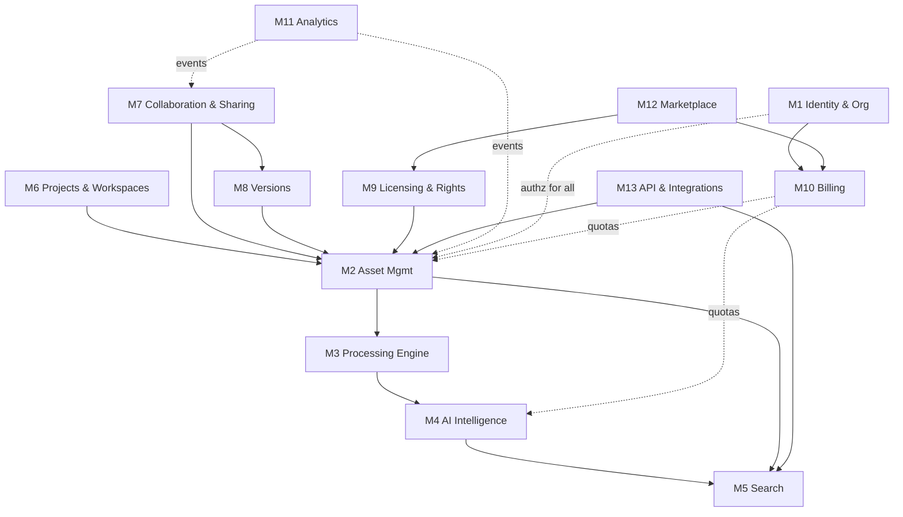

# Module Architecture (Phase 0.7)

Status: Proposed · Date: 2026-11-07
All modules live in one codebase (`backend/app/modules/<name>/`) with their own models, services, API router and an explicit **public interface** (`service.py`). Other modules may import only that interface. This is enforced by an import-linter rule in CI (ADR-001).

---

### MODULE 1 — Identity & Organization Management · **MVP P0**
| Field | Specification |
|---|---|
| Purpose | Who the user is, which orgs they belong to, what they may do |
| Responsibilities | User profile sync from IdP; orgs (personal + team); memberships; invitations; roles and permissions; API keys (P2); session/JWT validation; SSO config (P2) |
| Dependencies | External IdP (OIDC); M10 for seat limits |
| Data | `user`, `organization`, `membership(role)`, `invitation`, `api_key`, `sso_connection` |
| APIs | `GET /v1/me`, `POST /v1/orgs`, `POST /v1/orgs/{id}/invitations`, `PATCH /v1/orgs/{id}/members/{uid}` |
| Challenges | Personal → team org migration; SSO just-in-time provisioning; role model that is simple yet supports per-library restrictions |
| Security | JWT signature/audience/expiry checks; RLS session var; least-privilege defaults; audit every role change |

### MODULE 2 — Audio Asset Management · **MVP P0**
| Field | Specification |
|---|---|
| Purpose | System of record for audio files and their metadata |
| Responsibilities | Libraries, folders, assets; upload sessions (multipart); storage keys; technical + embedded metadata; tags (user + AI-accepted); UCS category; collections; soft delete / restore; batch download |
| Dependencies | M1 (authz), M3 (processing), M10 (storage quota), ObjectStore adapter |
| Data | `library`, `folder`, `asset`, `asset_file` (original/preview/peaks/spectrogram), `asset_metadata`, `tag`, `asset_tag`, `collection`, `collection_item`, `upload_session` |
| APIs | `/v1/libraries`, `/v1/assets`, `/v1/uploads`, `/v1/collections`, `/v1/assets/{id}/download` |
| Challenges | Very large ingests (100k+ files); dedupe; consistent states across storage + DB; keeping embedded metadata lossless |
| Security | Presigned URL issuance after authz; per-library permissions; upload validation; audit originals downloads |

### MODULE 3 — Audio Processing Engine · **MVP P0**
| Field | Specification |
|---|---|
| Purpose | Turn an uploaded file into a playable, analysable asset |
| Responsibilities | Validation (magic bytes, decode test); ffprobe; embedded metadata extraction; previews (AAC); waveform peaks; loudness (integrated LUFS, true peak, LRA); silence detection; spectrogram (P1); content hash; acoustic fingerprint (P1) |
| Dependencies | FFmpeg, audiowaveform, wavinfo/mutagen, ObjectStore; triggers M4 |
| Data | `processing_job`, `processing_step(status, pipeline_version, duration, error)`; writes `asset_metadata`, `asset_file` |
| APIs | Internal tasks only; admin: `POST /v1/admin/assets/{id}/reprocess` |
| Challenges | Malformed/hostile media; huge files (multi-GB); exotic formats (BWF poly, RF64, ambisonics); deterministic outputs for back-fills |
| Security | Sandboxed worker (no egress except storage, CPU/mem/time limits, non-root, read-only FS); never executes embedded content |

### MODULE 4 — AI Audio Intelligence · **MVP P0 (CLAP), P1 (PANNs, Whisper)**
| Field | Specification |
|---|---|
| Purpose | Machine understanding of audio: embeddings, tags, categories, transcripts |
| Responsibilities | Chunking + embedding (CLAP); zero-shot UCS/tag suggestions; AudioSet tagging (P1); transcription (P1); model registry and versioning; batch back-fills; per-tenant AI-hour metering |
| Dependencies | M3 outputs; GPU/CPU inference runtime; M10 quotas |
| Data | `embedding(asset_id, model_id, vector halfvec(512), chunk_idx)`, `ai_suggestion(asset_id, kind, label, score, status)`, `transcript`, `model_version` |
| APIs | Internal; `GET /v1/assets/{id}/suggestions`, `POST /v1/suggestions:bulk-review` |
| Challenges | Accuracy on fine-grained UCS; long files (pooling); model upgrades require re-embedding everything; cost control |
| Security | No training on customer data by default; GPU provider under DPA; models pinned by hash |

### MODULE 5 — Audio Search Engine · **MVP P0**
| Field | Specification |
|---|---|
| Purpose | Fast, relevant retrieval across a tenant's assets |
| Responsibilities | Query parsing; FTS + trigram; text-embedding of queries; vector kNN; hybrid fusion (RRF); facets/filters; "more like this"; saved searches (P1); search analytics |
| Dependencies | M2 data, M4 embeddings; `SearchIndex` interface (pgvector now, external engine later) |
| Data | `asset.search_tsv` (generated), `embedding` index (HNSW), `search_event` |
| APIs | `GET /v1/search`, `POST /v1/search/similar`, `GET /v1/search/facets` |
| Challenges | Filtered ANN recall in shared index; relevance tuning for pro vocabulary; latency at 1M+ assets/tenant |
| Security | Every query scoped by org + per-library permission; no cross-tenant candidate leakage (filter inside SQL, not post-filter in app) |

### MODULE 6 — Project & Workspace Management · **P1 (basic in P0 via collections)**
| Field | Specification |
|---|---|
| Purpose | Group work for a client/game/film: assets, collections, deliverables, members |
| Responsibilities | Projects, project members, deliverable lists, status; link collections and versions |
| Dependencies | M1, M2, M8 |
| Data | `project`, `project_member`, `deliverable`, `project_asset` |
| APIs | `/v1/projects`, `/v1/projects/{id}/deliverables` |
| Challenges | Avoid becoming a generic PM tool. Keep it audio-specific |
| Security | Project-level membership for guests/contractors |

### MODULE 7 — Collaboration & Sharing · **P0 (internal sharing), P1 (external review)**
| Field | Specification |
|---|---|
| Purpose | Let others hear, comment on and approve audio |
| Responsibilities | Share links (token, passphrase, expiry, download policy); time-coded comments (start/end ms, channel); approvals; notifications; guest identities |
| Dependencies | M2, M8, M1, email |
| Data | `share_link`, `comment(asset_version_id, t_start_ms, t_end_ms, body, author)`, `approval`, `notification` |
| APIs | `/v1/shares`, `/v1/public/s/{token}`, `/v1/comments`, `/v1/approvals` |
| Challenges | Guest UX with no account; abuse of public links (hosting pirated content) |
| Security | 128-bit tokens; rate limits; link revocation; audit; optional watermarked previews (P2); takedown flow |

### MODULE 8 — Version Management · **P1**
| Field | Specification |
|---|---|
| Purpose | Track iterations of a deliverable (mix v1→v7) |
| Responsibilities | Version stacks; immutable versions; current pointer; A/B compare; per-version loudness diff; comments bound to versions |
| Dependencies | M2, M3 |
| Data | `asset_version(asset_id, number, file_id, created_by, note)` (in P0 every asset has exactly one version, so the schema is ready) |
| APIs | `POST /v1/assets/{id}/versions`, `GET /v1/assets/{id}/versions` |
| Challenges | Storage growth; matching comments across versions |
| Security | Versions immutable; deletion only by Admin with audit |

### MODULE 9 — Licensing & Rights Management · **P0 (data model + fields), P2 (provenance, reports)**
| Field | Specification |
|---|---|
| Purpose | Know under which terms each sound may be used |
| Responsibilities | Licence records (owned, vendor EULA, CC variants, subscription); seat limits per library; attribution text; derived-asset provenance (P2); compliance report export (P2) |
| Dependencies | M2, M1 |
| Data | `licence`, `licence_assignment(library|asset)`, `asset_derivation(parent, child)`, `licence_evidence` (file) |
| APIs | `/v1/licences`, `/v1/assets/{id}/provenance` |
| Challenges | Licence terms are unstructured legal text; must not imply legal certainty |
| Security | Evidence docs private; changes audited |

### MODULE 10 — Subscription & Billing · **MVP P0**
| Field | Specification |
|---|---|
| Purpose | Plans, entitlements, quotas, payments |
| Responsibilities | Checkout via provider; webhook processing (idempotent); entitlement cache; quota metering (storage bytes, AI audio-seconds, seats, share links); dunning state; invoices via provider |
| Dependencies | Billing provider (Paddle/Stripe), M1 |
| Data | `plan`, `subscription` (mirror), `entitlement`, `usage_counter`, `usage_event` (append-only), `billing_webhook_event` |
| APIs | `POST /v1/billing/checkout`, `GET /v1/billing/subscription`, `POST /v1/webhooks/billing` |
| Challenges | Webhook ordering/idempotency; proration; quota enforcement without blocking ingestion mid-upload |
| Security | Webhook signature verification; no card data stored (PCI scope minimised) |

### MODULE 11 — Business Analytics · **P2 (internal product analytics in P0)**
| Field | Specification |
|---|---|
| Purpose | Usage insight for customers (library usage, team activity) and for us (product metrics) |
| Responsibilities | Event capture (domain events → analytics store); dashboards; per-tenant cost metering |
| Dependencies | Domain events from M2/M5/M7 |
| Data | `domain_event` outbox → analytics warehouse (later); privacy-filtered |
| APIs | `/v1/analytics/library-usage` (P2) |
| Challenges | Privacy (DPDP/GDPR consent for non-essential analytics) |
| Security | Pseudonymised IDs in product analytics; opt-out |

### MODULE 12 — Audio Marketplace · **P3**
| Field | Specification |
|---|---|
| Purpose | Sell and buy sound libraries with licences issued automatically |
| Responsibilities | Seller onboarding (KYC), listings, previews/watermarks, checkout, licence issuance, payouts, refunds, tax |
| Dependencies | M2, M9, M10, payment provider with marketplace payouts |
| Data | `seller`, `listing`, `order`, `licence_grant`, `payout`, `ledger_entry` |
| Challenges | Two-sided cold start; content-rights verification; tax/payout regulation |
| Security | KYC, fraud detection, takedown handling |

### MODULE 13 — External API & Integrations · **P2**
| Field | Specification |
|---|---|
| Purpose | Automate pipelines and connect tools |
| Responsibilities | Public REST API (same surface as `/v1`), API keys with scopes, webhooks (asset.ready, comment.created), BYO storage connectors (P1), desktop companion protocol (P2), engine/middleware export (P2) |
| Dependencies | All modules via their interfaces |
| Data | `api_key`, `webhook_endpoint`, `webhook_delivery`, `storage_connection` |
| Challenges | Backwards compatibility; rate limiting; BYO bucket permission errors |
| Security | Scoped keys, HMAC-signed webhooks, per-key rate limits; BYO credentials encrypted (KMS) with minimal IAM |

## MVP module summary
| P0 | M1, M2, M3, M4 (CLAP), M5, M7 (internal), M9 (fields), M10 |
|---|---|
| P1 | M4 (PANNs, Whisper), M6, M7 (external review), M8, M13 (BYO storage) |
| P2 | M9 (provenance), M11, M13 (public API, desktop companion) |
| P3 | M12 |
