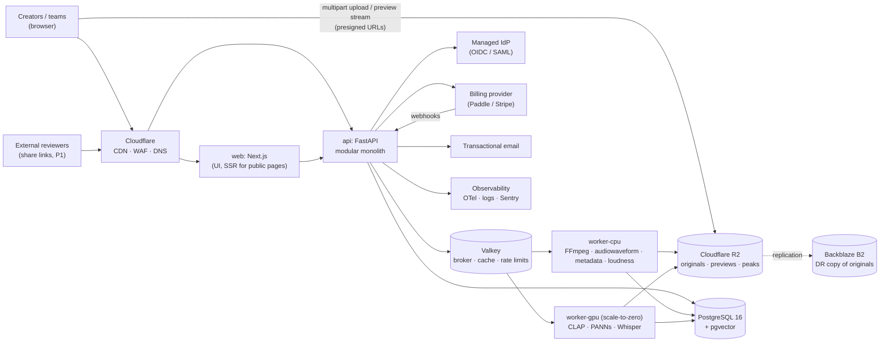
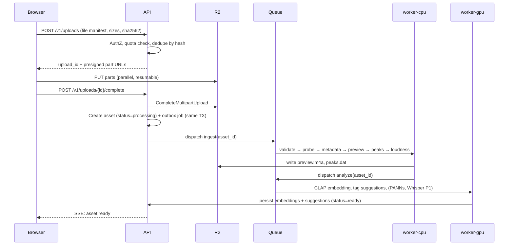
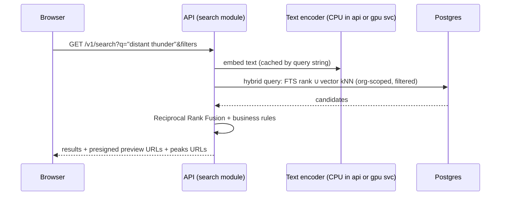

# System Architecture (Phase 0.7)

Status: **Proposed**, pending founder approval · Date: 2026-11-07 · Related: [ADRs](../decisions/architecture_decision_records.md)

## 1. Architectural style: modular monolith + asynchronous workers

### Modular monolith vs microservices
| Criterion | Modular monolith | Microservices |
|---|---|---|
| Team size fit (≈4 engineers) | ✅ One deployable API; simple local dev | ❌ Ops overhead per service |
| Transactions across modules (assets ↔ billing quotas ↔ audit) | ✅ Local ACID transactions | ❌ Sagas / eventual consistency everywhere |
| Independent scaling | ◐ **Solved by splitting only the workload that needs it**: CPU and GPU workers are separate processes from the same codebase | ✅ |
| Fault isolation | ◐ Worker isolation covers the riskiest code (media decoding, ML) | ✅ |
| Future extraction | ✅ If module boundaries are enforced (import rules, own tables, internal interfaces) | n/a |

**Decision (ADR-001):** One Python codebase with **enforced module boundaries**, deployed as three process types: `api`, `worker-cpu`, `worker-gpu`. Plus the Next.js `web` app. Extract a module into a service only when there is a measured need (team or scaling).

## 2. Context diagram

## 3. Key runtime flows

### 3.1 Upload & ingest

### 3.2 Search

## 4. Cross-cutting concerns
| Concern | Approach |
|---|---|
| Tenancy | `org_id` + RLS; per-request DB session variable; storage key prefixes |
| Idempotency | `Idempotency-Key` header on billable POSTs; idempotent workers keyed by `(asset_id, pipeline_version, step)` |
| Pipeline versioning | Each processing step records `pipeline_version` and model version → enables back-fills when models change |
| Reliability | Transactional outbox → queue; retries with exponential backoff; dead-letter queue + admin re-run |
| Observability | OpenTelemetry traces API → queue → worker; per-step durations; per-tenant cost metering |
| Config | 12-factor env config; feature flags per plan |
| Security | See [13_security_and_compliance.md](../research/13_security_and_compliance.md) |

## 5. Quality attribute targets [A]
| Attribute | Target (MVP) |
|---|---|
| Search p95 latency (≤1M assets/tenant) | < 500 ms end-to-end API |
| Preview start after click | < 1 s (p95) on broadband |
| Ingest throughput | ≥ 5,000 short SFX files/hour per CPU worker [A, benchmark] |
| Availability | 99.5% monthly (MVP), 99.9% (Business SLA later) |
| RPO / RTO | 15 min / 4 h (DB) |
