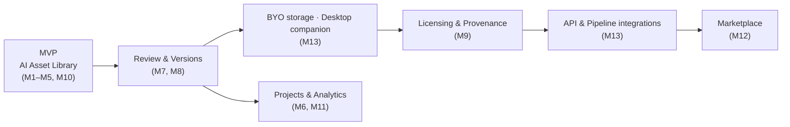

# Product Vision — AUDIO OS

Date: 2026-11-07 · Status: Draft for founder review

## Vision (long-term, 5+ years)
**AUDIO OS is the operating layer for professional audio work**: the place where every sound a team owns, creates, reviews and licenses is organised, understood by machines, and connected to the tools people already use.

## Mission (near-term)
Help sound professionals **find the right sound in seconds and share it with confidence**, across every library they own, from any browser.

## Positioning statement (MVP)
> **For** sound designers and small game-audio and post-production teams
> **who** lose time searching sprawling, badly-tagged sound libraries spread across drives and vendors,
> **AUDIO OS** is a cloud sound library
> **that** understands audio: search by description or by example, AI-suggested tags and UCS categories, and shareable team collections in the browser.
> **Unlike** desktop librarians (Soundminer, BaseHead, Soundly) and catalog-bound AI search (Splice),
> **AUDIO OS** brings AI discovery to *your own* libraries and makes them accessible to your whole team without installing anything.

## Product principles
1. **Originals are sacred.** Never modify, re-encode or lose metadata of a customer's source file.
2. **Audition speed is the product.** Every design decision protects time-to-sound.
3. **AI suggests, humans decide.** AI output is always reviewable and reversible.
4. **Your library stays yours.** No training on customer audio without opt-in; export everything, any time; BYO storage.
5. **Fit the workflow, don't replace the DAW.** Integrate with DAWs and existing librarians (UCS, BWF/iXML).
6. **Licences travel with sounds.** Rights information is first-class data.

## Long-term module path

## What AUDIO OS will not be (for now)
A DAW · a real-time streaming tool · a podcast recorder · a sample-catalog business · a generic DAM for video and images.
