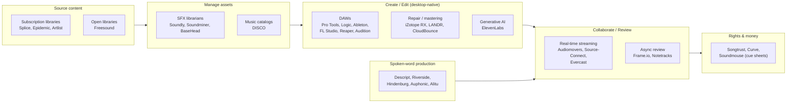

# 01 — Industry Overview (Phase 0.1)

Research date: 2026-11-07 · Evidence labels: see [README](../README.md)

## 1. How the audio software market is structured

The "audio software market" is really **six adjacent markets**. Each has different buyers, purchase habits and incumbents. The software is mostly **specialised point tools**, with users moving files between them by hand.

### Segment summary

| Segment | Typical delivery | Dominant business model | Incumbent strength | Notes |
|---|---|---|---|---|
| DAWs | Desktop (macOS/Windows), real-time DSP | Perpetual + upgrades, or subscription (Avid) | Very high. Decades of workflow lock-in, plugin ecosystems | A browser product should **not** compete here |
| Repair, mastering, AI processing | Desktop plugins and cloud | Perpetual tiers (iZotope), subscription bundles (LANDR), credits (ElevenLabs) | High | Moving to cloud and AI |
| Content libraries | Cloud catalog + desktop/DAW plugin | Subscription with credits (Splice) or licence-tiered subscription (Epidemic, Artlist) | High, with large catalogs | Business depends on catalog and licensing, not software |
| Asset management (SFX/music) | **Desktop-first** (Soundminer, BaseHead), hybrid cloud (Soundly), web (DISCO) | Perpetual (Soundminer [V] S04), subscription (Soundly, DISCO) | **Medium. Fragmented, prosumer-to-pro** | Main candidate area for AUDIO OS (see [07](07_market_gap_analysis.md)) |
| Collaboration and review | Real-time plugins (Audiomovers, Source-Connect), web review (Frame.io) | Subscription, per seat or per room | High in real-time; video-centric for async review | Async **audio-first** review is thinner |
| Spoken word / podcast | Web apps (Descript, Riverside, Auphonic, Alitu), desktop (Hindenburg) | Subscription with usage quotas (media hours, credit hours) | High and crowded | Heavy AI competition |
| Rights and royalties | Web, B2B | Commission (Songtrust [V] S24), SaaS tiers (Curve [V] S26), enterprise contracts (Soundmouse) | Medium to high, with regulation-heavy data | Consolidating: BMI agreed to acquire Soundmouse (May 2026) [T] S25 |

## 2. Structural trends observed (with evidence)

| Trend | Evidence | Label |
|---|---|---|
| Moving from perpetual licences to subscriptions, not always welcomed | Pro Tools sells Artist/Studio/Ultimate subscriptions (S27). Audiomovers moved LISTENTO to subscription-only (S64). Soundminer still sells perpetual V7 Basic $199 / Plus $399 / Pro $899 (S04). Logic iPad is subscription-only, Mac stays one-time $199.99 (S32) | [V]/[T] |
| Usage-metered pricing for AI and compute | Descript "media hours" and "AI credits" (S15). Auphonic credit hours (S17). ElevenLabs credits (S22) | [V]/[T] |
| ML-based discovery inside content catalogs | Splice "Similar Sounds" (2019) and "Search with Sound" in Ableton, Pro Tools and Studio One (S06, S07). DISCO similarity search and auto-tagging (S23). WAVS AI Sample Finder (S65) | [V]/[T] |
| Metadata standardisation for SFX | Universal Category System (UCS) is public domain; v8.2 described as the final release; Soundly announced full UCS compliance in 2022 (S03, S36). A 2026 DAFx paper calls UCS the dominant unified standard (S66) | [V]/[T] |
| Bring-your-own storage | Soundly's "Cloud Storage Freedom" (2022) lets Pro users connect Google Drive or Amazon S3 (S60) | [T] |
| Consolidation in rights and reporting | Orfium acquired Soundmouse (2023); BMI agreed to acquire it from Orfium (May 2026); Songtrust's parent Downtown is being acquired by Virgin/UMG (EC approval Feb 2026) (S24, S25) | [T] |
| Open-source infrastructure risk | MinIO community edition: admin UI removed (2025), source-only distribution (Oct 2025), repository archived (Feb 2026) (S43) | [T] |

## 3. Where a new web-based entrant can and cannot win

**Cannot realistically win (now):**
- Real-time editing and mixing (DAW territory). Browser audio cannot match native DSP latency and plugin ecosystems. [A, widely accepted]
- Catalog businesses (Splice, Epidemic, Artlist). These need a large licensed content catalog and royalty relationships, not software.
- Low-latency real-time streaming collaboration (Audiomovers, Source-Connect). Specialised codecs and plugins, and an entrenched pro user base.

**Plausible entry points (to validate):**
- **Cross-library audio asset management and discovery in the cloud.** Today's tools are desktop databases (Soundminer, BaseHead) or tied to one catalog (Splice). See [07](07_market_gap_analysis.md) G1–G3.
- **Audio-first async review and approval** (waveform-anchored comments, versions, loudness reports). Frame.io is video-first; specialist tools like Notetracks are small (S35, S61).
- **Glue workflows** that connect the segments above (ingest, tag, share, approve, deliver, keep licence metadata attached).

## 4. Unresolved research questions
1. How large is the paying population of independent sound designers and small post or game-audio teams? No credible primary data was gathered. Needs interviews plus proxies such as community sizes and Soundly/Soundminer user counts if disclosed.
2. How much of a typical pro's SFX library is commercial (licensed per user or per seat) versus self-recorded? This sets the licence and compliance constraints on cloud sharing.
3. Do commercial SFX library EULAs allow uploading licensed files to a shared multi-user cloud workspace? **This could block the team-library proposition.** It needs a review of the major vendor EULAs.
