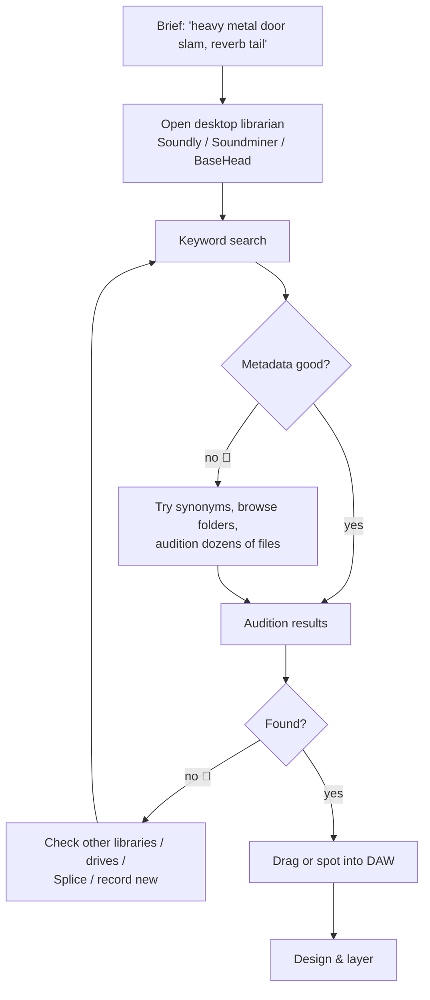
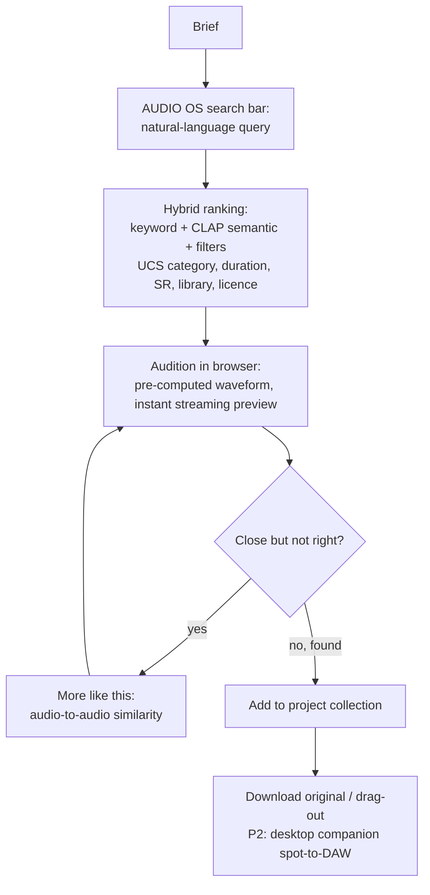
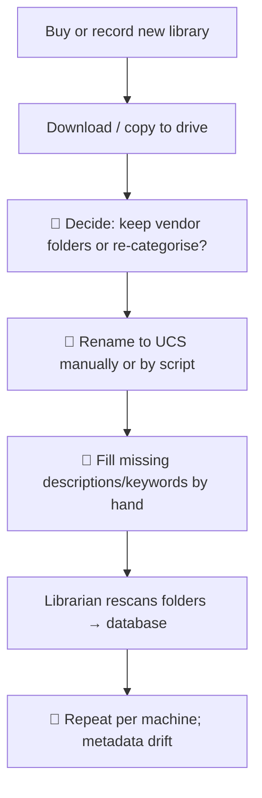
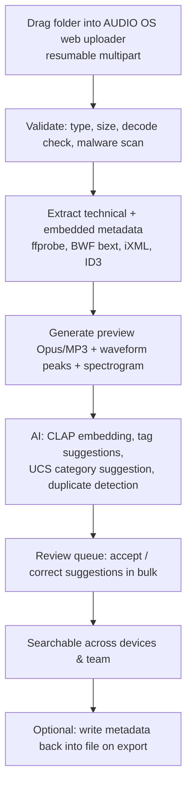
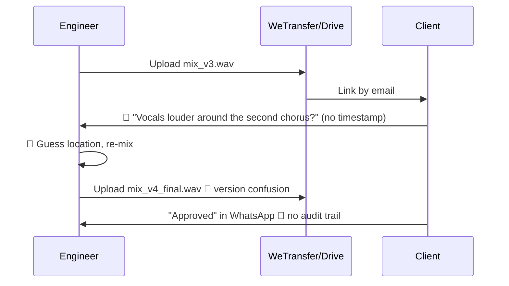
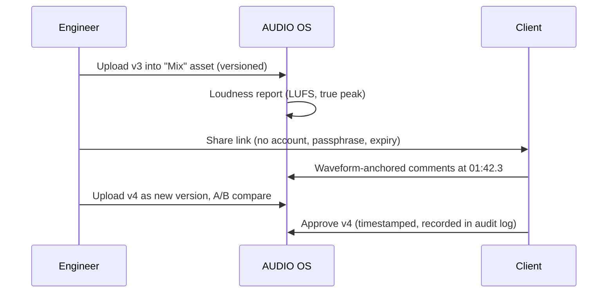
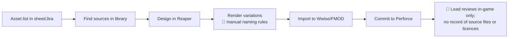
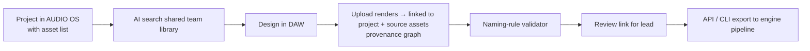
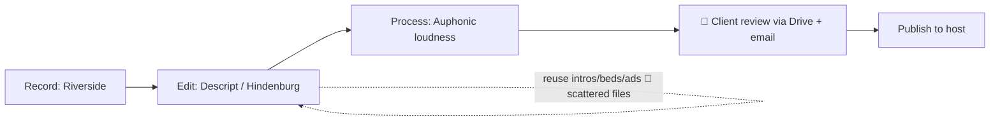
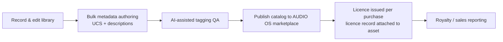

# 06 — Customer Workflows (Phase 0.4)

Research date: 2026-11-07 · Each workflow shows the **current (as-is)** journey and the **proposed AUDIO OS (to-be)** journey. As-is flows are based on typical industry practice [A/K] and must be confirmed in interviews.
🔴 = observed or hypothesised friction point.

---

## W1. Sound designer finds the right sound for a brief (core MVP journey)

**As-is**

**To-be (AUDIO OS)**

**Success metric:** median time-to-acceptable-result and number of files auditioned per search (baseline to be measured in usability tests).

---

## W2. Ingest and organise a new sound library

**As-is**

Evidence: Reddit discussion asking how professionals handle the first cleanup pass (keep vendor folders, rename, tag, import to Soundly/Soundminer/BaseHead) [T] S37; UCS naming recommended [T] S37, S36.

**To-be**

---

## W3. Mix / sound review and approval with a client

**As-is**

**To-be (P1 feature, not P0)**

---

## W4. Game-audio asset production and handoff

**As-is**

**To-be (P1–P2)**

---

## W5. Podcast episode production (secondary)

AUDIO OS role: **shared asset library** for reusable beds, intros and ads with licence metadata, plus **audio review**. Recording and editing stay with incumbents.

---

## W6. Audio library operator publishes a catalog (future, P3)

## Workflow-derived requirements (feed into MVP)
| Req ID | Requirement | From |
|---|---|---|
| WF-R1 | Search results with audible preview in < 1 s after click [A target] | W1 |
| WF-R2 | Natural-language and similarity search across all of the user's libraries | W1, W4 |
| WF-R3 | Bulk ingest of folders (thousands of files), resumable | W2 |
| WF-R4 | Preserve and read embedded BWF/iXML metadata | W2 |
| WF-R5 | AI tag suggestions with bulk accept/reject | W2 |
| WF-R6 | Collections / projects to group selected sounds | W1, W4 |
| WF-R7 | Share links with time-coded comments (P1) | W3 |
| WF-R8 | Version stack per asset (P1) | W3, W4 |
| WF-R9 | Licence/source metadata on every asset | W4, W6 |
| WF-R10 | Getting files into the DAW: download / drag-out; desktop companion later | W1 |
